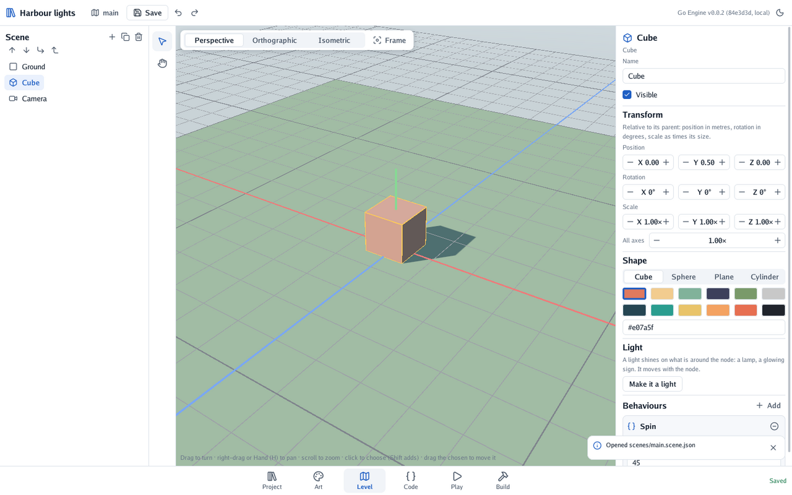
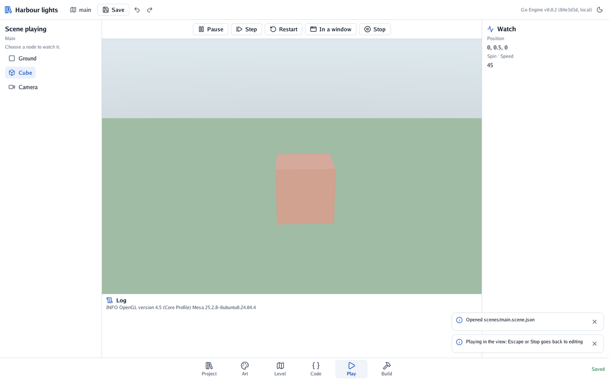
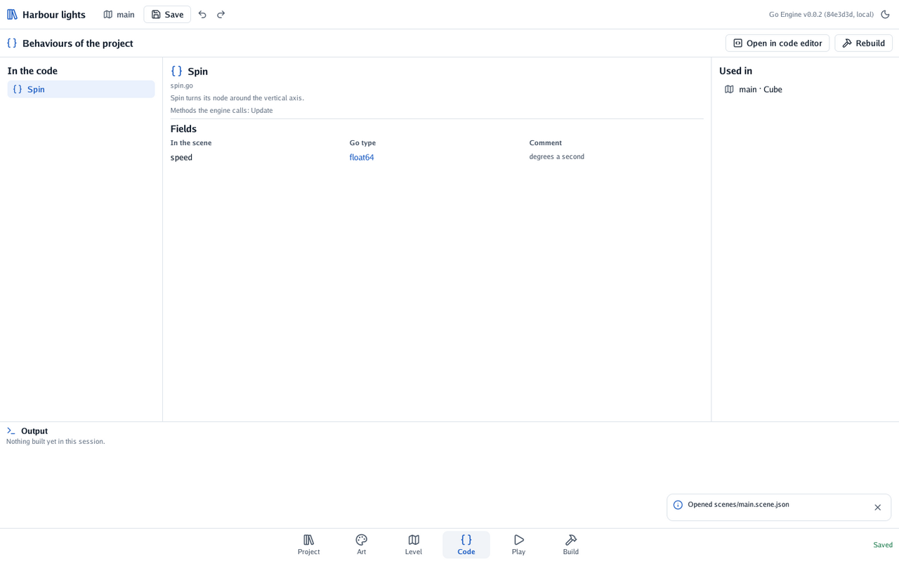

# 🚀 Get started

In fifteen minutes you install Go Engine, make a project, play its first scene in the editor and
change what its code does. Nothing here needs a game idea yet.

## What you need

- **Go 1.25** or newer ([go.dev/dl](https://go.dev/dl/)).
- **A C compiler**: the editor's window speaks to the graphics card through C. On Linux,
  `sudo apt install gcc libgl1-mesa-dev xorg-dev libwayland-dev libxkbcommon-dev` (Debian, Ubuntu); on macOS, `xcode-select --install`;
  on Windows, the gcc of [MSYS2](https://www.msys2.org) (Windows is still to be tried).
- **OpenGL 4.1**, which any computer of the last ten years has.

## 1. Install the editor

```bash
go install github.com/akrck02/go-engine/cmd/go-engine@latest
```

This puts a program called `go-engine` in Go's `bin` folder (`go env GOPATH`, then `bin`). If the
shell cannot find it, add that folder to your `PATH`.

## 2. Make a project

```bash
go-engine new ~/games/harbour "Harbour lights"
```

The second word is the game's name, as players will see it. A project is a folder with a Go module
inside; the command writes it, fetches the engine as `go` does any module, and opens the editor:

| File | What it is |
|---|---|
| `engine.json` | The game's name and the scene it starts with |
| `scenes/main.scene.json` | The first scene: a ground, a cube and a camera |
| `main.go` | Carries the scenes and assets inside the game, and starts it |
| `spin.go` | A first behaviour: the code that turns the cube |
| `editor.go` | Puts the editor inside the game while you make it |

**Checkpoint:** the editor shows a coloured cube on a green ground.

<p align="center"></p>

Next time, open the project with `go-engine ~/games/harbour`.

## 3. Look around

The bar at the bottom changes between six **workspaces**, one job each. The keys 1 to 6 do it too.

| Workspace | What it is for |
|---|---|
| **Project** | The project's files: pictures, models, scenes, and its settings |
| **Art** | Cutting a picture into frames for animations, or into tiles for levels |
| **Level** | Arranging a scene: the nodes on the left, the view, the inspector on the right |
| **Code** | The behaviours the project's Go code declares, and where they are used |
| **Play** | Playing the scene, with a pause, a step of one frame, and a log |
| **Build** | Making the game for a computer, the 3DS or an Android phone |

In **Level**, drag the view to turn round the scene, scroll to come closer, and click a thing in it
to choose it. Each thing in a scene is a **node**: the ground, the cube and the camera are three,
listed on the left. The chosen node's **inspector** on the right shows where it is, what it is,
and its behaviours.

## 4. Play

Press **Play** in the bar at the bottom (or 5): the scene starts playing at once, through its
camera, and the cube turns. Play always plays the scene as it is now, saved or not.

<p align="center"></p>

**Checkpoint:** the cube turns slowly. **Stop** (or Escape) goes back to the workspace you were
in, with the scene as it was before playing.

## 5. Change a number

Back in **Level**, choose the cube. Its inspector shows the **Spin** behaviour with a field,
**speed**, at 45. Make it 180 and play again: the cube spins four times as fast.

That field comes from the code. Open `spin.go` in your code editor:

```go
// Spin turns its node around the vertical axis.
type Spin struct {
	Speed float64 `json:"speed"` // degrees a second
}

// Update runs every frame, with the seconds since the last one in context.Delta.
func (spin *Spin) Update(context *engine.Context) {
	context.Node.Transform.Turn(space.Up, spin.Speed*context.Delta)
}
```

Every exported field of a behaviour is a field in the inspector, named by its JSON name. `Update`
runs every frame; `context.Delta` is the seconds since the last frame. `main.go` registers the
behaviour, so scenes can name it:

```go
engine.Register(Spin{})
```

## 6. Change the code

Make the cube bob up and down as it turns. Add a field and two lines to `spin.go`:

```go
import (
	"math"

	"github.com/akrck02/go-engine/engine"
	"github.com/akrck02/go-engine/space"
)

type Spin struct {
	Speed float64 `json:"speed"` // degrees a second
	Bob   float64 `json:"bob"`   // metres up and down
}

func (spin *Spin) Update(context *engine.Context) {
	context.Node.Transform.Turn(space.Up, spin.Speed*context.Delta)
	context.Node.Transform.Position.Y = 0.5 + spin.Bob*math.Sin(context.Time*3)
}
```

`context.Time` is the seconds since the scene started. The editor runs inside your game, so it
needs the game built again: open **Code** (or 4) and press **Rebuild**, which glows while the code
is newer than the game. It saves the scene, builds, and reopens the editor where you were; if the
code does not compile, the error shows under **Output**, and the editor stays as it was. **Open in
code editor** opens the project in the editor `engine.json` names (`codeEditor`), or in `$VISUAL`.

<p align="center"></p>

**Checkpoint:** the cube's inspector now has a **bob** field. Make it 0.5 and play: the cube bobs.

## 7. Play it on its own

In **Build** (or 6), the card **This computer** has **Build**, which writes the game into the
project's `build/` folder, and **Play**, which opens it in a window of its own. From a terminal,
`go run .` in the project's folder plays it too: the editor only starts when `go-engine` asks.

The other cards make the game for the Nintendo 3DS and for Android phones. The tools they need are
set up in **Tools**, the tab beside **Platforms** at the top of Build; the
[guides](5-guides/6-building-for-the-3ds.md) explain them.

## Where next

- 🗺️ [The quest](4-the-quest/0-the-quest.md): make a whole platformer, a level at a time.
- 💡 [Core ideas](3-core-ideas.md): what a scene, a node and a behaviour really are.

---

[← Overview](1-overview.md) · [Core ideas →](3-core-ideas.md)
