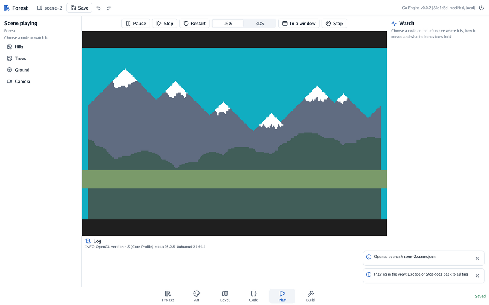

# 🧭 Level 1: a forest of your own

You make the game's project, a 2D scene, and the forest behind everything: hills, trees and a sky.
At the end you can play it, even though nothing moves yet.

#### The idea

A 2D scene is a stage seen from the front. Its pictures are flat cut-outs standing at different
depths: the hills at the back, the trees in front of them, later the slime in front of all. The
**camera** is the window the player looks through.

## The project

```bash
go-engine new ~/games/forest "Forest"
```

The editor opens on a 3D scene with a cube. This game is 2D, so it needs pictures. Take the
forest's from the engine's own example:

```bash
git clone --depth 1 https://github.com/akrck02/go-engine.git /tmp/go-engine
cp -r /tmp/go-engine/examples/platformer/assets/sprites ~/games/forest/assets/
```

In **Project** (key 1) the folder `sprites` appears, with the pictures: the forest's tiles, its
backdrops, a slime, a coin, spikes and a sign.

## A 2D scene

1. Click the scene's name at the top (**main**) and choose **New 2D scene**. It opens with a green
   ground, a square and a camera.
2. Choose the **Square** in the tree on the left and delete it with the bin above the tree.
3. Click an empty part of the view to choose nothing: the inspector shows the **Scene**. Name it
   *Forest*, make the sky `#11adc1`, and set **Pixels per metre** to 16. The forest's tiles are 16
   pixels across, so each tile will be a metre.

## The backdrop

1. In **Project**, open `sprites` and choose `background-far.png`. Press **Place in the scene**.
2. The editor goes back to **Level**, where the picture is a node named after it. Rename it
   *Hills*, and set its **Draw order** to 0.1.
3. Do the same with `background-near.png`: name it *Trees*, draw order 0.2. A greater draw order
   is drawn in front.
4. Drag both so they sit together behind the ground.

## The camera

Choose the **Camera**. Its inspector says how many metres it sees: set **Metres seen, top to
bottom** to 9.4 and **across** to 15.5. Drag it over the hills; the white frame is what the player
will see.

Last, tell the game to start here. In **Project**, press **Settings** and choose this scene as
**The scene the game starts with**. Save with Ctrl+S.

## Checkpoint

Press **Play** (key 5).

<p align="center"></p>

You see the hills, the trees and the green ground through the camera. Press **3DS** above the view
to see it at the console's shape.

## Bonus: a dusk sky

Make the sky the deep blue of a late evening.

<details>
<summary>🔓 Show the solution</summary>

Choose nothing, then in the scene's inspector set the sky to `#1d3557`. The pictures stay the same;
only the sky behind them changes. In level 5 the whole forest goes dark, with lights.

</details>

**🧭 Achievement unlocked: Explorer.** You made a project, a 2D scene and a camera.

---

[← The quest](0-the-quest.md) · [Level 2 →](2-a-slime-that-walks.md)
