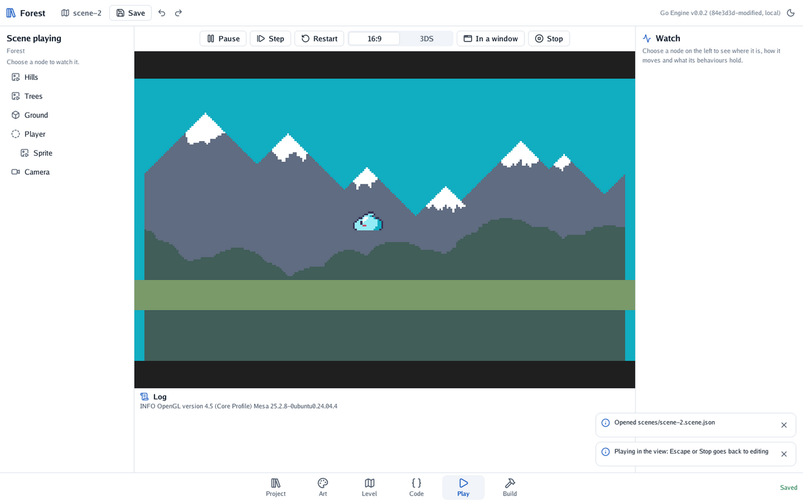

# 🎭 Level 2: a slime that walks

You bring in the hero, a slime, give it a body that falls and stands, and write your first
behaviour: the code that walks and jumps when the player presses the arrows and Space.

#### The idea

The slime is two nodes, as a puppet is a body and a costume. **Player** is the body: the physics
moves it, and your code tells it where to go. Its child **Sprite** is the costume: the picture
that follows the body and plays its animations. Keeping them apart lets the costume sit a little
higher than the body, or change, without the physics noticing.

## The slime's animations

In **Project**, choose `slime.sprite.json` and press **Open in Art**. A **sprite file** cuts a
picture into frames, here 5 across and 2 down, and names runs of them: **idle** is one frame,
**walk** four frames at 3 a second, looping. Press **Play it when the scene starts** beside an
animation to watch it.

To make one of your own, choose any picture in Project and press **Make it a sprite or a tileset**.

## Something to stand on

Choose the **Ground**, and under **Body** press **Give it a body**. Leave it **Solid**: it never
moves, and what falls lands on it.

## The body

1. Press **+** above the tree and choose **Empty**. Name the new node *Player*.
2. Give it a body, and choose **Moving**. Set its size: width 0.94, height 0.63 metres, the
   slime's own shape.
3. Set **Gravity** to 5.75. A slime falls much faster than a stone would; it feels better in a game.
4. Drag it above the ground.

## The costume

1. With *Player* chosen, go to **Project**, choose `slime.sprite.json` and press **Place in the
   scene**. A new node lands after *Player*.
2. Press **Make it a child of the node above** (↳) over the tree. Name it *Sprite*, and set its Y to
   0.19, so the slime's feet sit on its body's bottom.

## The code

Add a file `player.go` beside `main.go`:

```go
package main

import "github.com/akrck02/go-engine/engine"

// Player walks with the arrows (or the 3DS's cross), jumps with Space (or A) while it stands on
// the ground, and plays its sprite's animations.
type Player struct {
	Speed float64 `json:"speed"` // metres a second, walking
	Jump  float64 `json:"jump"`  // metres a second, upwards, when it jumps
}

// Update runs every frame.
func (player *Player) Update(context *engine.Context) {
	body, found := context.Node.Body()
	if !found {
		return
	}
	direction := context.Input.Move().X
	body.Velocity.X = direction * player.Speed
	if context.Input.Pressed(engine.KeySpace) && body.OnFloor() {
		body.Velocity.Y = player.Jump
	}
	player.animate(context.Node, direction)
}

// animate plays "walk" while the player walks and "idle" while it stands, facing the way it goes.
func (player *Player) animate(node *engine.Node, direction float64) {
	sprite, found := node.Find("Sprite")
	if !found {
		return
	}
	if direction == 0 {
		sprite.Play("idle")
		return
	}
	sprite.Play("walk")
	sprite.FaceLeft(direction > 0) // the slime is drawn facing left
}
```

The code never moves the slime itself. It sets the body's **velocity**, how fast it goes, and the
physics moves it, stopping it at the ground. `Move()` is -1, 0 or 1 across, from the arrows, the
3DS's cross or a phone's buttons. `OnFloor()` keeps the slime from jumping in the air.

Then register it in `main.go`, beside `Spin`:

```go
engine.Register(Spin{}, Player{})
```

In **Code** (key 4), press **Rebuild**. The editor builds the game again and reopens where you were.

## The behaviour

Choose *Player*. Under **Behaviours**, press **Add** and choose **Player**. Its fields appear: set
**speed** to 3.2 and **jump** to 18.75.

## Checkpoint

Press **Play**. The slime falls onto the ground; the arrows walk it, Space jumps.

<p align="center"></p>

The slime should turn the way it walks, and wobble while it walks. If it does not move, check in
**Code** that *Player* is listed, and that the node's behaviour is spelled the same.

## Bonus: run

Make the slime run twice as fast while Shift (or the 3DS's X) is held.

<details>
<summary>🔓 Show the solution</summary>

`Down` tells whether a key is held now, where `Pressed` tells whether it was just pressed:

```go
speed := player.Speed
if context.Input.Down(engine.KeyShift) || context.Input.Down(engine.KeyX) {
	speed *= 2
}
body.Velocity.X = direction * speed
```

</details>

**🎭 Achievement unlocked: Puppeteer.** You gave a node a body and moved it with your own code.

---

[← Level 1](1-a-forest-of-your-own.md) · [Level 3 →](3-ground-to-stand-on.md)
