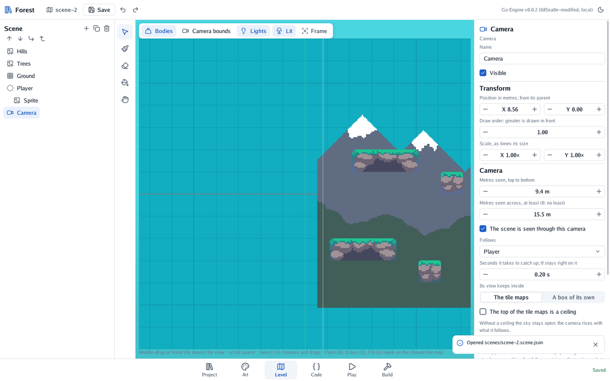
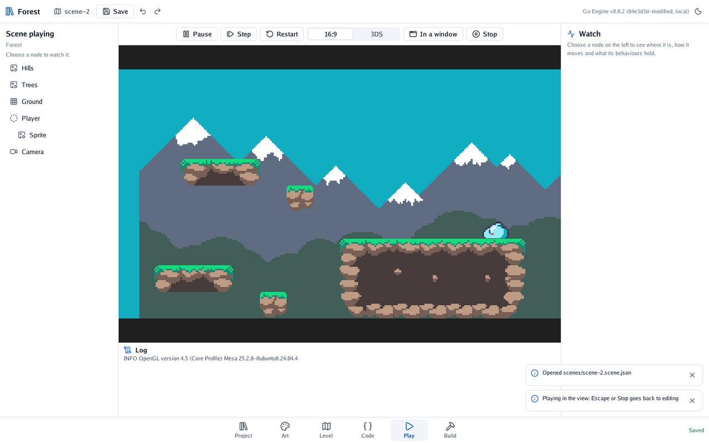

# 🧱 Level 3: ground to stand on

The green box was a stand-in. Now you paint a real level with the forest's tiles, ledges to jump
between, and make the camera follow the slime through it.

#### The idea

A **tile map** is a grid, like squared paper, and a **tileset** is a box of stamps: small square
pictures of grass, rock and earth. Painting the level is stamping tiles into squares. Some stamps
are **solid**: the physics turns each row of solid tiles into ground, so you never draw a body for
the floor by hand.

## The tileset

In **Project**, choose `forest.tileset.json` and press **Open in Art**. It cuts the forest's
picture into tiles of 16 pixels. The tiles tinted blue are solid: grass on top, rock and earth
below. Click a tile on the picture to make bodies stand on it; click it again to let them through.

## The map

1. In **Level**, delete the green box, *Ground*: the tiles will be the ground now.
2. Press **+** and choose **Tile map**. Name it *Ground*.
3. In its inspector, choose the tileset `assets/sprites/forest.tileset.json`.
4. Set the cells: 14 across, 8 down. The map's top-left corner is the node's position. Keep the
   slime above where you will paint.

## Painting

The **palette** under the view shows the tileset. Choose a tile in it, then a tool on the left of
the view:

| Tool | Key | What it does |
|---|---|---|
| Paint | B | Stamps the tile where you click or drag |
| Erase | E | Empties the cells you click or drag |
| Fill | G | Fills the empty cells joined to the one you click |
| Select | V | Back to choosing and dragging nodes |

Paint a long ledge for the slime to start on, then two or three smaller ones, each a jump away.
**Bodies**, over the view, fills the solid tiles in blue: that is where the slime will stand.

## A camera that follows

Choose the **Camera**. Under **Follows**, choose *Player*, and set the smoothing to 0.2 seconds: the
camera catches up gently instead of jerking. Leave **Its view keeps inside** on **The tile maps**,
so the player never sees past the level's edges.

## Checkpoint

Press **Play** and run from ledge to ledge.

The camera follows the slime, and stops where the tiles end. If the slime falls through a ledge,
check in Art that its tiles are solid.

## Bonus: a gap that matters

Leave a gap two tiles wide between two ledges, and make the slime need a run-up to cross it.

🔓 Show the solution

Erase (E) two cells of a ledge. At a speed of 3.2 metres a second and a jump of 18.75, the slime
clears two metres easily; to make it hard, set its **speed** to 2.5 in the inspector. The level's
difficulty lives in the scene's numbers, so try them in Play and change them without touching the
code.

You painted a level and made the camera follow your hero.

---

[← Level 2](2-a-slime-that-walks.md) · [Level 4 →](4-coins-and-water.md)
