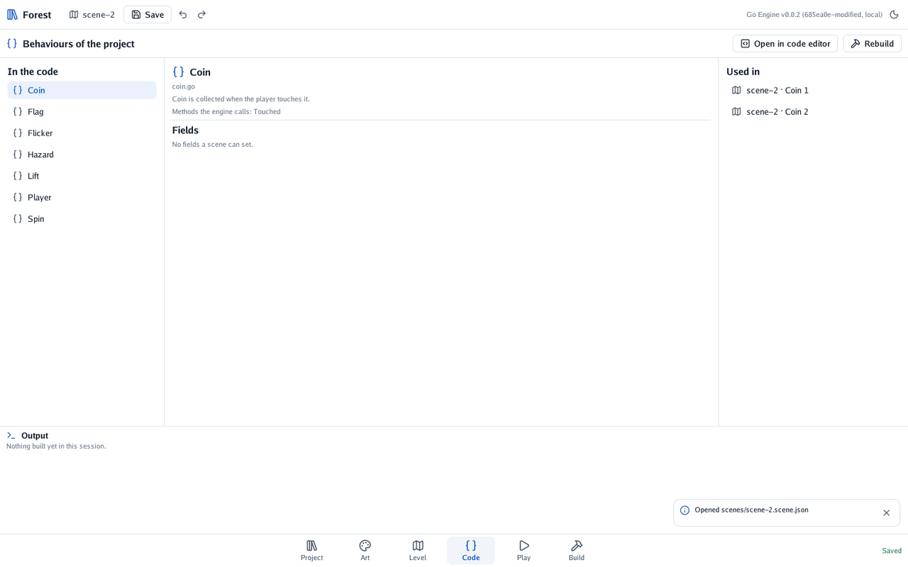
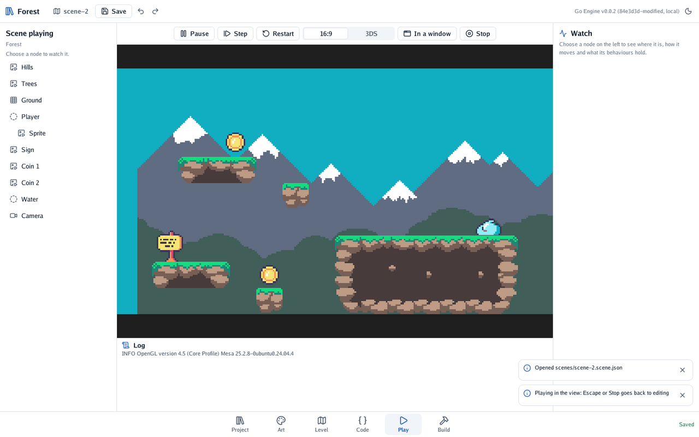

# 🪙 Level 4: coins and water

A level needs something to win and something to lose. You add coins that vanish when touched,
water that sends the slime back to the start, and a sign that ends the level.

#### The idea

A **trigger** is a body that stops nothing: an invisible tripwire. When a moving body walks into
it, the engine calls the trigger's behaviours with `Touched`, and tells them what touched. A coin,
a pool of water and a finishing sign are the same thing with different code.

## The code

Three small behaviours, each in its own file beside `main.go`. `coin.go`:

```go
package main

import "github.com/akrck02/go-engine/engine"

// Coin is collected when the player touches it.
type Coin struct{}

// Touched runs when a moving body begins touching the coin.
func (coin *Coin) Touched(context *engine.Context, other *engine.Node) {
	player, found := engine.Behaviour[Player](other)
	if !found {
		return
	}
	player.Coins++
	context.Node.Remove()
}
```

`engine.Behaviour[Player](other)` finds the `Player` behaviour on what touched, so only the slime
collects coins. Give `Player` somewhere to count them, a field the scene does not set:

```go
	Coins int `json:"-"` // the coins collected: not a setting
```

`hazard.go` starts the level again, and `flag.go` goes to another scene:

```go
// Hazard starts the level again when the player touches it: spikes, water.
type Hazard struct{}

func (hazard *Hazard) Touched(context *engine.Context, other *engine.Node) {
	if _, isPlayer := engine.Behaviour[Player](other); isPlayer {
		context.RestartScene()
	}
}
```

```go
// Flag ends the level when the player touches it, and goes on to the next one.
type Flag struct {
	Next string `json:"next"` // the next level's scene file, as "scenes/forest-2.scene.json"
}

func (flag *Flag) Touched(context *engine.Context, other *engine.Node) {
	if _, isPlayer := engine.Behaviour[Player](other); isPlayer {
		context.ChangeScene(flag.Next)
	}
}
```

Each file starts with `package main` and imports `engine`, as `player.go` does. Register them in
`main.go`, `engine.Register(Spin{}, Player{}, Coin{}, Hazard{}, Flag{})`, and press **Rebuild**.
**Code** then lists them, with where each is used:

<p align="center"></p>

## Coins

1. In **Project**, place `coin.sprite.json`. It spins: the sprite file starts its **spin**
   animation by itself.
2. Give it a body, **Trigger**, 1 by 1 metres. Add the behaviour **Coin**.
3. Drag it over a ledge. Press **Duplicate** (Ctrl+D) for more, and drag each where a jump reaches.

## Water

Under the ledges, the slime falls forever. Catch it:

1. Press **+**, **Empty**, and name it *Water*. Drag it under the level.
2. Give it a body, **Trigger**, 30 metres wide and 4 high. Add the behaviour **Hazard**.

It is invisible, and needs not be seen: falling off is the danger. **Bodies** over the view draws
triggers in orange.

<p align="center"></p>

## The sign

1. Place `sign.png` at the level's far end. Give it a body, **Trigger**, 1 by 2 metres.
2. Add the behaviour **Flag**, and set **next** to `scenes/scene-2.scene.json`: this same level, for
   now. The bonus makes a second one.

## Checkpoint

Press **Play**. Collect the coins, fall into the water, start again, and reach the sign.

<p align="center"></p>

In **Play**, choose *Player* in the list on the left: **Watch** shows where it is and how it moves,
frame by frame. **Pause** and **Step** stop the game and move it one frame at a time.

## Bonus: a second level

Make a second level, and send the sign there.

<details>
<summary>🔓 Show the solution</summary>

Copy the scene file in your file manager or terminal:

```bash
cp ~/games/forest/scenes/scene-2.scene.json ~/games/forest/scenes/forest-2.scene.json
```

The editor lists it in the scene menu at the top. Open it, rename it *Forest 2* in the scene's
inspector, and repaint its ledges. In the first level, set the sign's **next** to
`scenes/forest-2.scene.json`. In the second, set it back to the first, so the game loops.

</details>


Your level can be won and lost.

---

[← Level 3](3-ground-to-stand-on.md) · [Level 5 →](5-night-in-the-forest.md)
