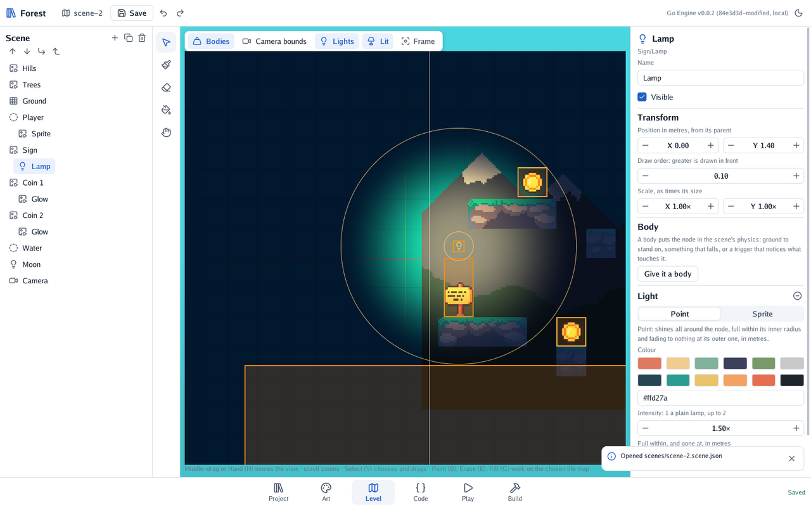
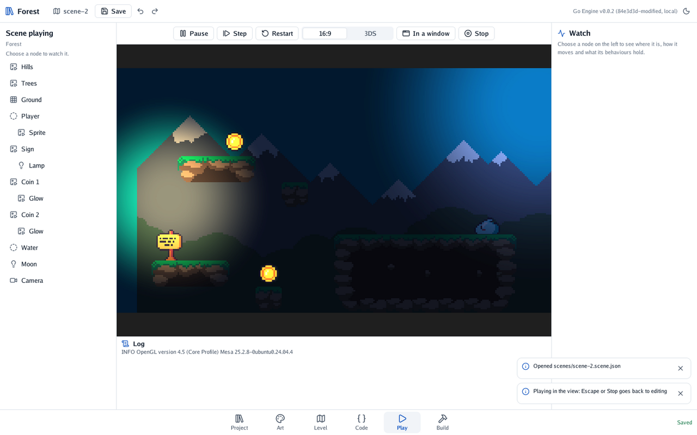

# 🏮 Level 5: night in the forest

Night falls on the forest. You darken it with an ambient light, hang a lamp over the sign, make the
coins glow and let a cold moonlight in. No code, except for the bonus.

#### The idea

Think of the level as a stage. The **ambient** is the house lights: how much of everything you can
see when nothing else shines. Each **light** is a spotlight: it adds its colour where it reaches,
strongest in its middle and fading at its edge. A **sprite light** is a light in the shape of a
picture: a coin that glows exactly where its gold is.

## Dusk

Choose nothing (click an empty part of the view). In the scene's inspector, tick **An ambient light
of its own**. Make it a dark blue, `#30406e`, at an **intensity** of 0.55. The forest dims at once:
the view shows the scene lit as the game will be. **Lit**, over the view, switches that on and off
while you work.

## A lamp over the sign

1. Choose the *Sign*. Press **+** and choose **Light**: a warm lamp lands after it.
2. Press **Make it a child of the node above** (↳), so the lamp moves with the sign. Name it *Lamp*
   and set its Y to 1.4, just above the board.
3. In its **Light** section, keep **Point**. Set the intensity to 1.5, **Inner** to 0.5 metres and
   **Outer** to 4.

**Lights**, over the view, draws two circles round it: where its light is full, and where it ends.

<p align="center"></p>

## Coins that glow

1. Choose a coin, and from **Project** place `coin.sprite.json` again. Make it a child of the coin
   (↳) and name it *Glow*.
2. Under **Light**, press **Make it a light** and choose **Sprite**. Make it `#ffe08a`, at 1.2.

A sprite light is not drawn itself: it shines in its picture's shape, so the coin seems to glow from
inside. Do the same for each coin, or glow one and duplicate the coin.

## Moonlight

Press **+**, **Light**, and drag it high over the far end of the level. Make it a pale blue,
`#9ab8ff`, at 0.8, with an inner radius of 1 and an outer of 7.

## Checkpoint

Press **Play** and run through the dark.

<p align="center"></p>

The lamp warms the sign and its ledge, the coins glow, and the far end is blue under the moon. The
light the lamp throws on the sky beyond the hills is part of the scene too: everything drawn is lit.

## Bonus: a lamp that flickers

Make the lamp waver, as a flame does.

<details>
<summary>🔓 Show the solution</summary>

A behaviour can change its node's light every frame. Add `flicker.go`:

```go
package main

import (
	"math"

	"github.com/akrck02/go-engine/engine"
)

// Flicker makes its node's light waver, as a flame does.
type Flicker struct {
	Base float64 `json:"base"` // the intensity it wavers round

	strength float64 // this frame's: the light reads it
}

// Update sets this frame's strength from two waves that never quite repeat.
func (flicker *Flicker) Update(context *engine.Context) {
	light, found := context.Node.Light()
	if !found {
		return
	}
	flicker.strength = flicker.Base + 0.2*math.Sin(context.Time*13) + 0.1*math.Sin(context.Time*29)
	light.Intensity = &flicker.strength
}
```

Register `Flicker{}`, press **Rebuild**, and give the lamp the behaviour with a **base** of 1.5.
The light keeps pointing at the behaviour's own number, so a frame makes no new one: games that run
sixty frames a second on a console care about that.

</details>


You lit a scene with an ambient, lamps and glows.

---

[← Level 4](4-coins-and-water.md) · [Level 6 →](6-in-your-pocket.md)
