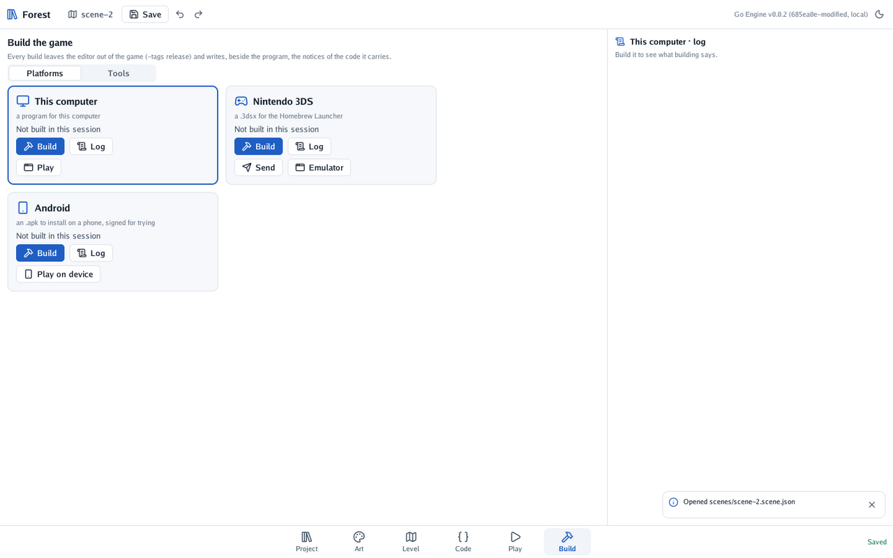
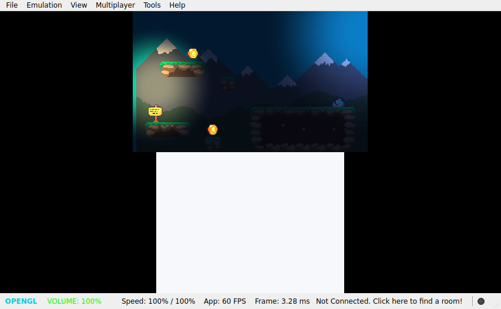

# 🎒 Level 6: in your pocket

Your forest is a game. Now it leaves the editor: a program for your computer, a `.3dsx` for a
Nintendo 3DS, and an `.apk` for an Android phone. Then a final challenge.

#### The idea

The same Go code becomes three programs. For a computer, Go builds it as it is. For the 3DS,
[TinyGo for the 3DS](https://github.com/akrck02/tinygo-3ds) builds it for the console's processor,
and devkitPro packs it for the Homebrew Launcher. For Android, the phone's tools wrap it in an app.
The editor runs each of them for you, from **Build** (key 6).

## On your computer

In **Build**, the card **This computer** has **Build**: it writes the game into `build/`, without
the editor inside, with the notices of the code it carries beside it. **Play** opens it in a window
of its own. Send that folder to a friend on the same system, and they can play.

<p align="center"></p>

## On a Nintendo 3DS

The 3DS needs two tools. Open the **Tools** tab:

1. Beside **TinyGo**, press **Install**. It downloads TinyGo for the 3DS's latest release and
   remembers where it put it.
2. Beside **devkitPro**, press **Install**. Its own installer opens in a terminal and asks for your
   password: it installs `3ds-dev`.
3. For an emulator, press **Install** beside **3DS emulator**: it fetches Azahar.

Back in **Platforms**, the **Nintendo 3DS** card's **Build** writes `build/forest.3dsx`.
**Emulator** opens it in Azahar:

<p align="center"></p>

On a real console with the Homebrew Launcher, open the Launcher and press Y, then press **Send**: the
game travels over Wi-Fi and starts. The cross walks, A jumps.

## On an Android phone

In **Tools**, install the **Android SDK**, which brings the **Android NDK** with it (you read and
accept its licence first), and a **JDK** if the computer has none. Plug a phone in with USB debugging on, or start an emulator, then press
**Play on device** on the **Android** card. The game shows round buttons to walk and jump, and its
log streams into the editor while it runs.

<p align="center"></p>

## Checkpoint

Your game runs somewhere other than the editor. On the 3DS it holds 60 frames a second, lights and
all.

## 🏆 Final challenge: a lift

The level's far end gets a cliff too high to jump. Build a lift: a ledge that rises and sinks, and
carries the slime up.

Hints: a body of the kind **Platform** moves at the velocity its behaviours give it, and carries
what stands on it. A behaviour can remember where its node started in `Start`.

<details>
<summary>🔓 Show the solution</summary>

`lift.go`:

```go
package main

import "github.com/akrck02/go-engine/engine"

// Lift rises and sinks between where it starts and some metres higher, carrying what stands on
// it. Its node has a body of the kind Platform.
type Lift struct {
	Speed    float64 `json:"speed"`    // metres a second
	Distance float64 `json:"distance"` // metres it rises

	bottom float64 // where it starts
}

// Start remembers where the lift starts.
func (lift *Lift) Start(context *engine.Context) {
	lift.bottom = context.Node.World().Position.Y
}

// Update turns the lift round at the top and at the bottom.
func (lift *Lift) Update(context *engine.Context) {
	body, found := context.Node.Body()
	if !found {
		return
	}
	height := context.Node.World().Position.Y - lift.bottom
	switch {
	case height >= lift.Distance:
		body.Velocity.Y = -lift.Speed
	case height <= 0 || body.Velocity.Y == 0:
		body.Velocity.Y = lift.Speed
	}
}
```

Register `Lift{}` and press **Rebuild**. Place a ledge picture (or a **Square**, 3 by 0.5 metres)
at the cliff's foot, give it a body of the kind **Platform** and the behaviour **Lift**, with a
**speed** of 1.5 and a **distance** of 4. In Play, the slime rides it up.

</details>


Your game runs on a computer, a console and a phone.

You finished the quest. 🎉 The [guides](../5-guides/1-a-2d-level-with-tiles.md) go further into each
part, and the [complete game](https://github.com/akrck02/go-engine/tree/main/examples/platformer) has
three levels to compare with yours.

---

[← Level 5](5-night-in-the-forest.md) · [The guides →](../5-guides/1-a-2d-level-with-tiles.md)
