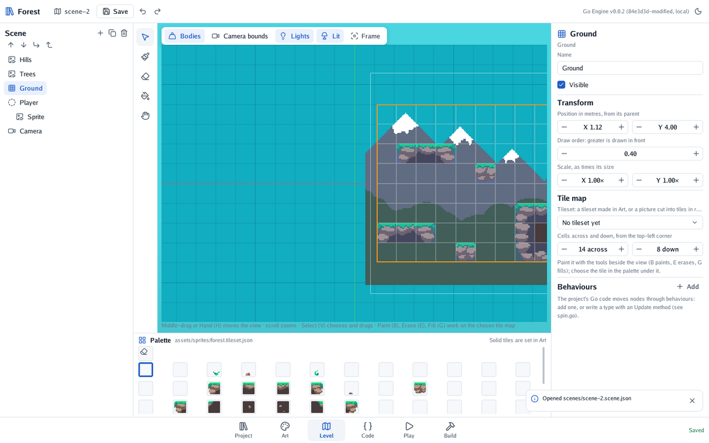
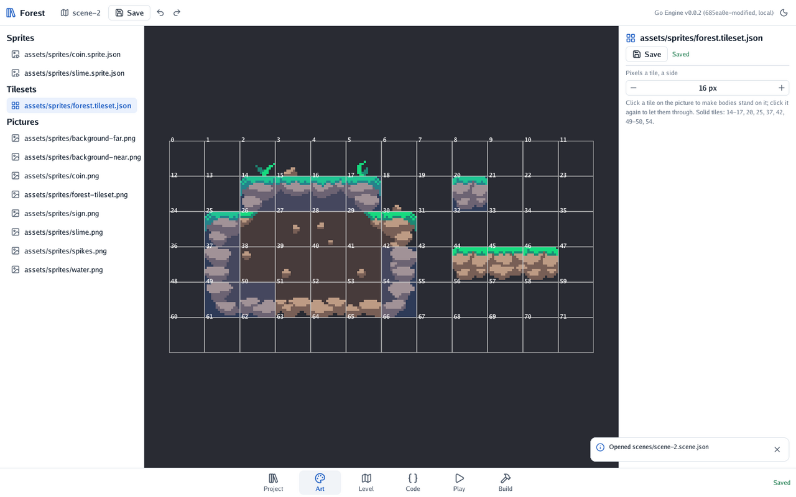

# 🧱 A 2D level with tiles

Paint a level with a tileset, and let its solid tiles be the ground. For a first walk through it,
see [level 3 of the quest](../4-the-quest/3-ground-to-stand-on.md).

## The shortest way

1. In **Project**, choose a picture of tiles and press **Make it a sprite or a tileset**, then
   **A tileset**. Set **Pixels a tile, a side** (16, 32…) and save. The tileset is a file beside the
   picture, `name.tileset.json`, that every scene shares.
2. Still in **Art**, click the tiles bodies should stand on: they turn blue, solid.
3. In **Level**, press **+**, **Tile map**, and choose the tileset in its inspector. Set how many
   cells across and down it has.
4. Choose a tile in the **palette** under the view, and paint: **B** paints, **E** erases, **G**
   fills, **V** goes back to choosing nodes.

Set the scene's **pixels per metre** to the tile's size, so a tile is a metre.

## How it behaves

| | |
|---|---|
| Where | The map's top-left corner is its node's position; a cell is a tile's pixels at the scene's pixels per metre |
| Solid tiles | Each run of solid tiles side by side becomes one solid box while the game plays: the ground, walls and ceilings |
| Depth | The map is drawn at its node's draw order, like any 2D node |
| Several maps | A scene can have many: a background one with no solid tiles, a foreground one to stand on |

## Variations

- **A bare picture as tiles.** A tile map can name a picture instead of a tileset. Its inspector
  then asks for the tile size, and the palette has **Bodies stand on tile …** to choose solid ones.
  A tileset is better as soon as two scenes share the tiles.
- **Bigger or smaller maps.** Changing the cells across and down keeps what is painted from the
  top-left corner, and empties the rest.
- **A camera inside the level.** A camera that follows keeps its view inside the tile maps: see
  [A camera that follows](5-a-camera-that-follows.md).

---

[← Guides](../1-overview.md#where-to-start) · [Sprites and animations →](2-sprites-and-animations.md)
