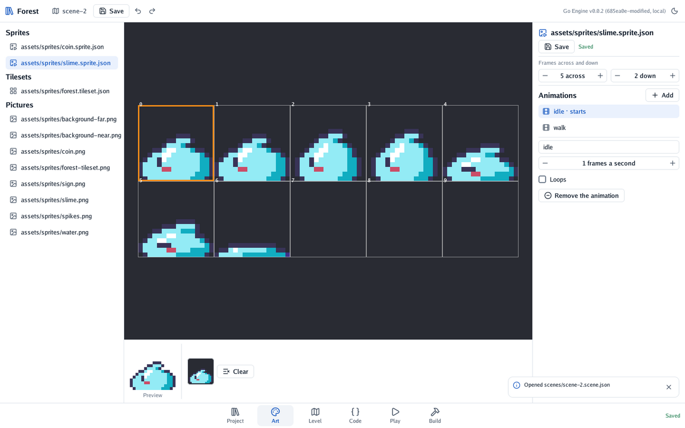

# 🎞️ Sprites and animations

Show a picture in a 2D scene, cut a sheet into frames, and play its animations from code.

## A picture

In **Project**, choose a picture (PNG or JPEG) and press **Place in the scene**. It is as large as
its pixels at the scene's **pixels per metre**, times the node's scale.

## An animated sprite

1. Choose the sheet's picture and press **Make it a sprite or a tileset**, then **A sprite**.
2. In **Art**, set the **frames across and down**: a sheet of 4 frames in a row is 4 by 1.
3. Under **Animations**, press **Add**, name it (*walk*), and click its frames on the picture, in
   order. Set its frames a second, and whether it **Loops**.
4. **Play it when the scene starts** makes it the one a node starts with. Save.

The sprite is a file, `name.sprite.json`, that every scene shares. Place it like a picture.

<p align="center"></p>

## From code

```go
func (hero *Hero) Update(context *engine.Context) {
	if context.Input.Move().X != 0 {
		context.Node.Play("walk") // keeps playing if it already is
	} else {
		context.Node.Play("idle")
	}
	context.Node.FaceLeft(context.Input.Move().X < 0) // mirrors the picture
}
```

| Call | What it does |
|---|---|
| `node.Play(name)` | Plays an animation of the node's sprite, from its start unless it is already playing; false if there is none of that name |
| `node.FaceLeft(left)` | Draws the picture mirrored, or not |

## Variations

- **A costume on a body.** Put the sprite on a child of the node with the body, so it can sit a
  little higher or lower than the body's box (see [level 2 of the quest](../4-the-quest/2-a-slime-that-walks.md)).
- **Nodes that start differently.** A node's inspector chooses the animation it starts with; nodes
  sharing one sprite file can each start on another.
- **Pixel art stays sharp.** Sprites are drawn at the nearest pixel, never blurred.

---

[← A 2D level with tiles](1-a-2d-level-with-tiles.md) · [Bodies and physics →](3-bodies-and-physics.md)
