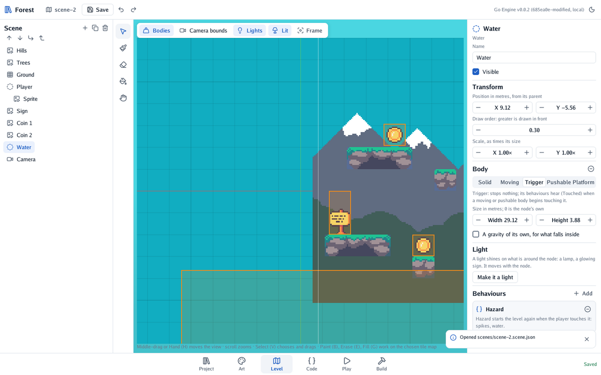

# 🪨 Bodies and physics

Make 2D nodes fall, stand, push and carry each other, and move them from code.

## Give a node a body

Choose the node, and under **Body** press **Give it a body**. Choose its kind:

| Kind | Use it for |
|---|---|
| Solid | Ground and walls: it never moves |
| Moving | The player and enemies: falls, moves at its velocity, stops against solids |
| Pushable | Boxes: falls, can be stood on, and is pushed when walked into |
| Platform | Lifts: moves as its behaviours say, carrying what stands on it |
| Trigger | Coins, doors, water: stops nothing, hears what touches it |

Its **size** is in metres; 0 is the node's own picture or shape.

<p align="center"></p>

 Moving and pushable bodies have a
**gravity** scale: 1 is Earth's, more falls faster, 0 floats.

## Move it from code

```go
func (hero *Hero) Update(context *engine.Context) {
	body, found := context.Node.Body()
	if !found {
		return
	}
	body.Velocity.X = context.Input.Move().X * 4 // metres a second
	if context.Input.Pressed(engine.KeySpace) && body.OnFloor() {
		body.Velocity.Y = 12
	}
}
```

Set the **velocity**; never move a body's node by hand while it plays, or the physics loses it.
`OnFloor()` tells whether the body stands on something.

## Hear what touches a trigger

```go
func (door *Door) Touched(context *engine.Context, other *engine.Node) {
	if _, isPlayer := engine.Behaviour[Player](other); isPlayer {
		context.ChangeScene("scenes/house.scene.json")
	}
}
```

Moving and pushable bodies touch triggers; `Touched` runs once, when the touch begins.

## Gravity zones

A trigger can pull with a gravity of its own: tick **A gravity of its own, for what falls inside**
and set the pull across and up, in metres a second each second (the world's is 0, -9.81). A field
that lifts things is a pull upwards. A body that should keep the world's gravity anyway (the
player walking through a field meant for boxes) ticks **Keeps the world's gravity inside zones**.
"On the floor" follows the pull: a body pulled up stands on a ceiling.

## Variations

- **The world's gravity.** `context.Scene.Physics().SetGravity(…)` changes it for the whole scene.
- **Tiles as ground.** Solid tiles of a tile map are solid bodies already: see
  [A 2D level with tiles](1-a-2d-level-with-tiles.md).
- **A lift.** A platform with a behaviour that turns its velocity round at the top and bottom: the
  [final challenge of the quest](../4-the-quest/6-in-your-pocket.md#-final-challenge-a-lift).

---

[← Sprites and animations](2-sprites-and-animations.md) · [Lights →](4-lights.md)
