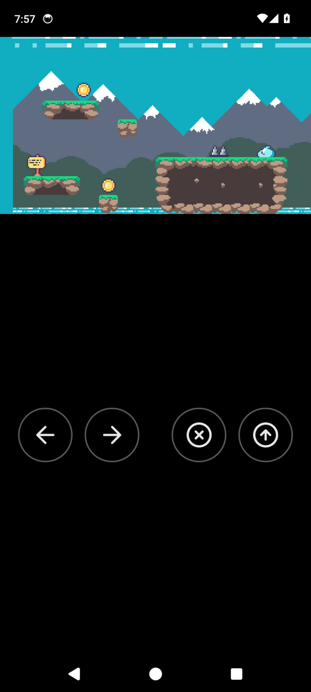

# 📱 Building for Android

Turn a game into an `.apk`, and play it on a phone or an emulator with its log in the editor.

## The tools

In **Build → Tools**, press **Install** beside:

| Tool | What it is for |
|---|---|
| Android SDK | Building and installing: Google's command-line tools, platform-tools, build-tools and a platform. Its licence is shown first, to read and accept |
| Android NDK | The C compiler for phones; it comes with the SDK |
| JDK | Java 17 or newer, which Android's tools need |

Android Studio's SDK and JDK are found too, if it is installed.

## Build and play

On the **Android** card:

| Button | What it does |
|---|---|
| **Build** | Writes `build/<name>.apk`, signed for trying |
| **Play on device** | Builds, installs on the phone or emulator `adb` sees, starts the game, and shows its log until it ends |

A phone needs **USB debugging** on (in its developer options) and a cable, or an emulator started.

## How the game behaves there

- **Touch buttons.** The game draws round buttons for the arrows, B and A; a keyboard plugged in
  still works.
- **TalkBack.** With a screen reader on, the buttons are read as *Left*, *Right*, *B* and *A*. A
  double tap presses one for a moment; a double tap held holds it, as a finger does.
- **Held upright or sideways.** Sideways, the game fills the screen. Upright, it sits at the top at
  its camera's shape, with the buttons under it. A camera's **metres seen across** keeps the
  level's sides in view.
- **The application id.** Android names apps by an id, as `io.example.forest`; set it in **Project →
  Settings**.

---

[← Building for the 3DS](6-building-for-the-3ds.md) · [The 3DS's bottom screen →](8-the-3ds-bottom-screen.md)
