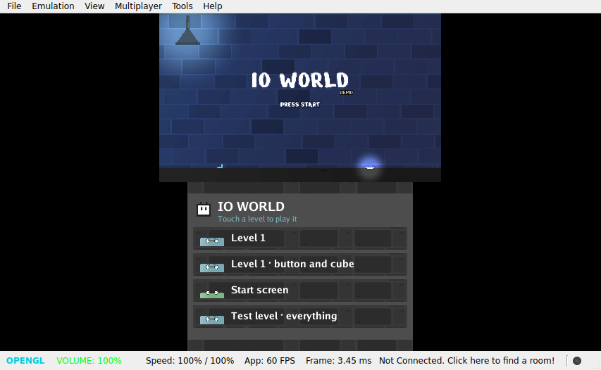

# 🕹️ The second screen

Use a device's second screen (the 3DS's bottom one): a ready-made menu of the game's scenes, a
screen drawn by the game itself, or a 3D scene of its own under it.

## A menu of the scenes

In **Project → Settings**, tick **List the scenes in the game's interface, to play any**. The
second screen then lists every scene; a touch plays it. It is handy while making a game, to jump
to any level.

## A screen of your own

<p align="center"></p>


`engine.SetInterface` draws the game's interface with [Go UI](https://github.com/akrck02/go-ui), in
the game's own look: on the second screen of a device that has one, over the window elsewhere. Call it in `main.go`, before `engine.Run`:

```go
func main() {
	engine.Register(Player{})
	engine.SetInterface(levels)
	if err := engine.Run(files); err != nil {
		log.Fatal(err)
	}
}

// levels lists the levels, the one playing chosen; a touch plays another.
func levels(context *ui.Context, menu engine.Menu) {
	for _, scene := range menu.Scenes() {
		playing := menu.Playing() != nil && menu.Playing().Name == scene.Name
		if context.Selectable("map", scene.Name, playing) {
			menu.Play(scene.File)
		}
	}
}
```

| Call | What it gives |
|---|---|
| `menu.Scenes()` | The project's scenes, each with its file and name |
| `menu.Playing()` | The scene playing, or nil |
| `menu.Play(file)` | Plays another scene |

It needs `import ui "github.com/akrck02/go-ui"`, which the engine already brings. The function runs every frame the interface is drawn. On the 3DS it fills the second screen, 320 ×
240 pixels, where touch is its pointer; on a computer and a phone it is laid over the game's view.

The interface is the game's surface named `interface`: engine.json's `surfaces` can put it
elsewhere on a target, and a game can show more surfaces beside it with `engine.SetSurface`
([Surfaces on each screen](10-surfaces-on-each-screen.md)).

## Variations

- **A map, a score, the controls.** Anything Go UI draws can be there: text, pictures, buttons.
- **A 3D scene under it.** `engine.SetSecondScreen(scene)` plays a scene of its own on the second
  screen, seen from its main camera, with the interface over it: a map that turns, a model in a shop.
- **The same scene on a computer.** A computer has no second screen, so that scene plays but is
  not shown. `engine.PlaceSecondScreen(&area)` shows it in an area of the window, in window pixels,
  under the game's own drawing: a radar in a corner. Call it again when the window's size changes;
  `nil` hides it, and a 3DS ignores it.
- **Its own pictures.** Read a picture once (`draw2d.DecodeImage`) and paint it with
  `context.Paint`; the [Io World](https://github.com/akrck02/io-world/tree/main/IoWorldGo) game draws
  its menu of levels from its own bricks this way.

---

[← Building for Android](7-building-for-android.md) · [Actions and controls →](9-actions-and-controls.md)
