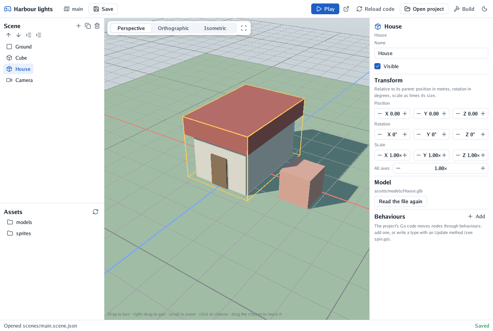
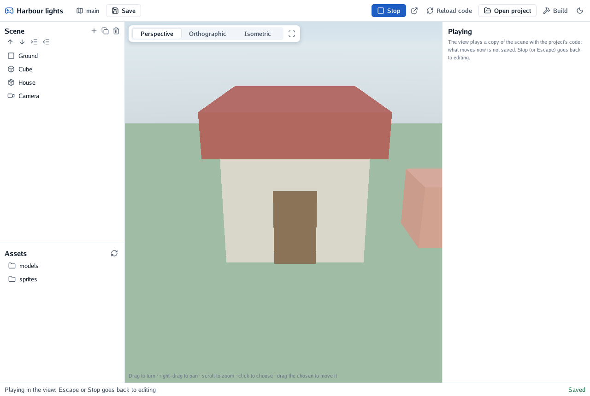
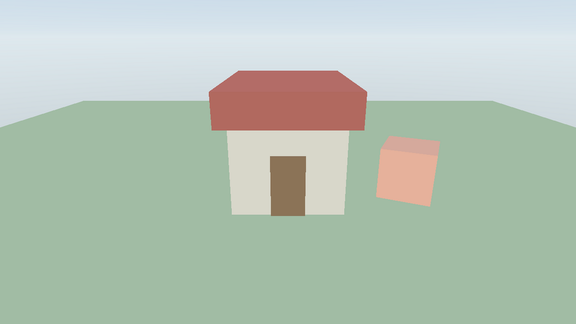
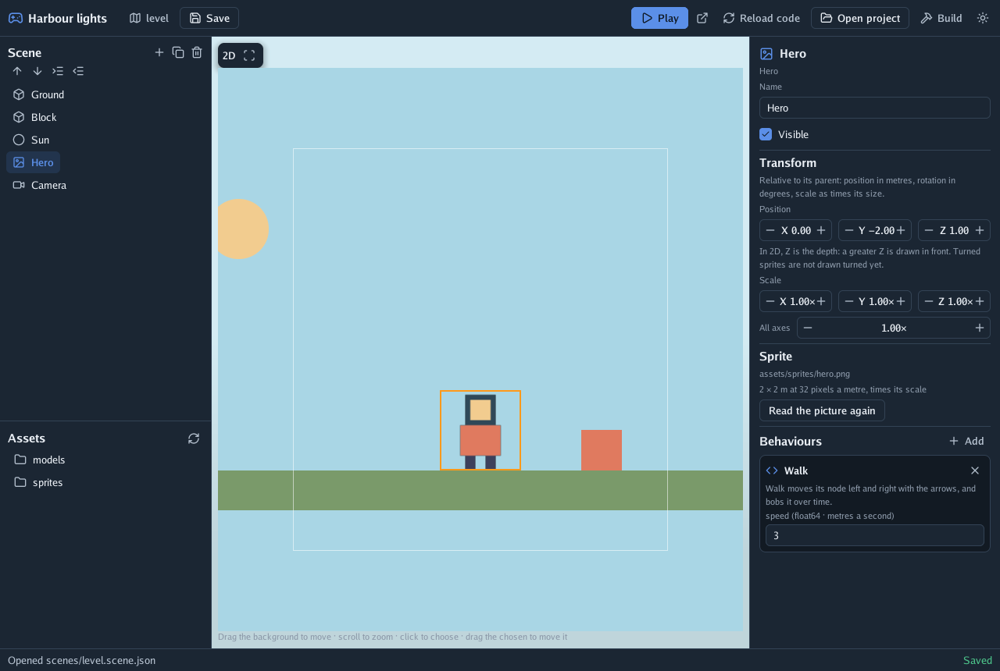
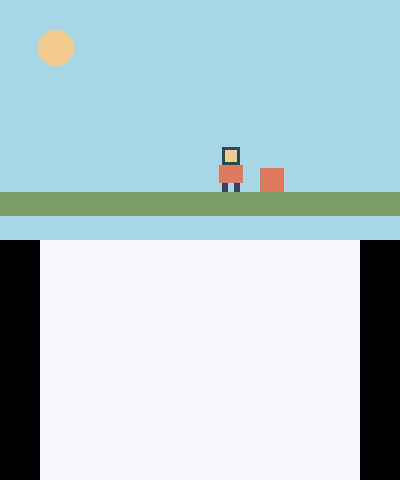
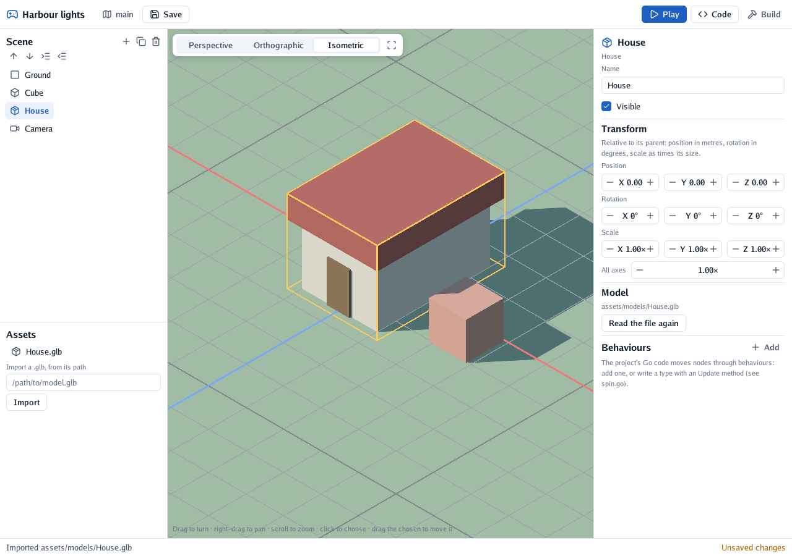
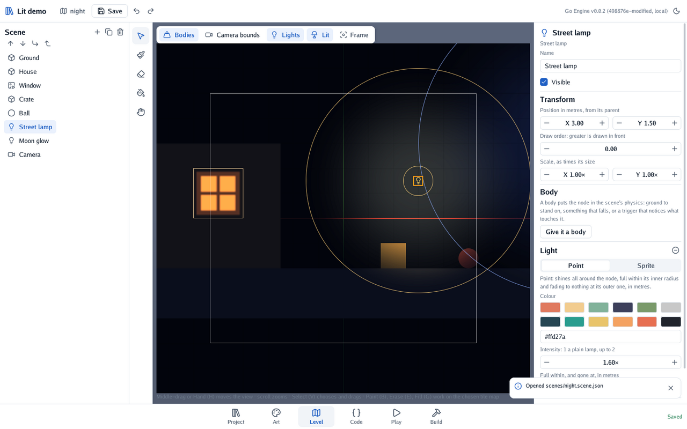

# 🎮 go-engine

> 🚧 **Go Engine is in development.** What these pages describe can change from one version to
> the next: names, scene files and the editor's layout included.

go-engine is a game engine in Go for 2D, 3D and isometric games, with an editor. A game is an
ordinary Go module: the editor arranges its scenes and imports its assets, and the game's own
code, written in any editor that speaks Go (Zed, Neovim, Visual Studio Code, GoLand…), moves what
is in them through a small standard library.

| Page | What it covers |
|---|---|
| This page | A project, the editor, the standard library, coordinates |
| [style-guide.md](style-guide.md) | How the code is written: names, functions, errors, packages and modules |

## A project

```bash
go run ./cmd/go-engine new ~/games/harbour "Harbour lights"   # make one and open it
go run ./cmd/go-engine ~/games/harbour                        # edit it
cd ~/games/harbour && go run .                                # play it in a window of its own
```

**The editor runs inside the game.** go-engine builds the project's game with the editor in it
(`editor.go`, left out of builds for the 3DS and of finished ones, `-tags release`) and starts it
in the project's folder. So the editor knows the game's behaviours, compiled in, and **Play**
plays them right in its view. When the code changes, **Reload code** builds the game again and
reopens the editor in it, on the same scene and node (the button stands out while the code is
newer than the game).

| File | What it is |
|---|---|
| `engine.json` | The project's name, the scene it starts in, and the code editor to open (`codeEditor`) |
| `scenes/*.scene.json` | The scenes, as the editor writes them: readable, and kind to version control |
| `assets/models/*.glb` | Imported models |
| `main.go` | Embeds the project's files, registers the behaviours, runs the engine |
| `editor.go` | Puts the editor in the game while it is made (go-engine adds it to older projects) |
| `spin.go` | A first behaviour: how the code reaches a scene |
| `.vscode/launch.json`, `.zed/tasks.json` | "Play" from Visual Studio Code and Zed; in Neovim, `:!go run .` |

The project's `go.mod` builds against the go-engine the editor came from, so gopls finds the
engine's code and its documentation as for any other module.

## The editor

<p align="center">
  
</p>

| Where | What |
|---|---|
| Toolbar | The scene (and new 3D or 2D ones), **Save** (Ctrl+S), **Play**/**Stop** in the view, the game in a window of its own, **Reload code**, **Open project** (in Zed), **Build** for this computer or the Nintendo 3DS, and dark or light mode |
| Left | The scene's nodes as a tree: add, duplicate (Ctrl+D), delete, reorder, hang a node from the one above or take it out. Below, the **assets**: the project's `assets` folder as a tree, read again every few seconds; whatever is copied there (from the file manager, from Zed) shows. Click a model to place it in a 3D scene, a picture to place it as a sprite in a 2D scene |
| Middle | The view, with a switch that makes the scene 3D or 2D. In 3D: drag to turn, right-drag to pan, scroll to zoom; perspective, orthographic or isometric (a fixed angle: dragging pans). In 2D: drag the background to move, scroll to zoom. In both, click a node to choose it and drag the chosen one to move it; F frames it |
| Right | The inspector: name, transform, shape and colour, model or sprite, camera, and behaviours with their fields; with nothing chosen, the scene (sky, pixels per metre in 2D) |

**Play** plays a copy of the scene in the view, drawing every frame while it plays,, with the project's code, through the scene's main
camera; Escape or **Stop** goes back to the scene as it was. The button beside it builds the game
and plays it in its own window instead; its output shows in the status line. **Build** writes the
program into `build/`, with `THIRD_PARTY_NOTICES.md` beside it (for the 3DS it needs
[tinygo-3ds](https://github.com/akrck02/tinygo-3ds); set `$TINYGO` if it is not on the path).
The 3DS card also sends the game to the console's Homebrew Launcher (press Y there first; it needs
devkitPro's `3dslink`, `$DEVKITPRO`) or opens it in an emulator (Azahar or Citra on the path, or
`$EMULATOR_3DS`). The Android card builds an `.apk` (the Android SDK and NDK: `$ANDROID_HOME`,
`$ANDROID_NDK_HOME`, or Android Studio's) and plays it on the phone or emulator `adb` sees, with
its log; on a phone the game shows touch buttons, and a 2D camera's **width** keeps the level's
sides in view when the phone is held upright. The settings keep the Android application id and
the 3DS's address. Where each of these tools is (TinyGo, devkitPro, the emulator, the Android
SDK and NDK) is set in Build's **Tools on this computer**, kept for every project in
`go-engine/tools.json` of the user's configuration folder; a place set there (typed, or chosen
with **Browse**) comes before the variables, and an empty one looks for the tool as above.
**Install** beside each tool fetches it into `go-engine/` of the user's data folder and sets its
place: TinyGo for the 3DS from [tinygo-3ds](https://github.com/akrck02/tinygo-3ds)'s releases,
Azahar from its latest release (each checked against the checksum published), and the Android
SDK with its NDK through Google's own tools, once its licence, shown in a sheet, is accepted (they
need Java, a JDK 17 or newer). devkitPro is installed by its own installer, `dkp-pacman -S 3ds-dev`,
in a terminal where it asks for the system's password; without it, Install opens devkitPro's guide.
Project's **Import model** copies a `.glb` chosen the same way into `assets/models`.

<p align="center">
  
</p>

<p align="center">
  
  
</p>

## 2D

<p align="center">
  
  
</p>

A scene is 3D or 2D (`"mode": "2d"` in its file; the **3D | 2D** switch over the view, or **New 2D
scene**). A 2D scene has
the same coordinates, in metres with Y up, seen from the front by an orthographic camera: its
**Height seen** is how many metres fit from top to bottom.

| | |
|---|---|
| Sprites | Pictures (PNG, JPEG) from the assets, as large as their pixels at the scene's **pixels per metre** (32 by default: a sprite 32 pixels high stands a metre high), times the node's scale |
| Shapes | A cube or a plane is a square a metre across, a sphere a circle, in its colour |
| Depth | Z: a node with a greater Z is drawn in front; with the same Z, in the scene's order |
| Drawing | Through draw2d: in the editor's view and the desktop's window by go-ui's interface, on the 3DS on the top screen |

`engine.View2D` turns points of the world into points of the screen and back, for a game's own
drawing. Turned sprites are not drawn turned yet (draw2d draws pictures upright).

## Coordinates and scale

| | |
|---|---|
| Unit | One unit is a metre (`space.Metre`, `space.Centimetre`) |
| Axes | Y up; X to the right; Z towards whoever looks: right-handed, as glTF and go-renderer |
| Forward | A node with no rotation faces `space.Forward`, -Z; a camera looks that way |
| Rotation | In degrees, as `space.Angles{X, Y, Z}`: X tilts (pitch), Y turns (yaw), Z rolls; applied roll, pitch, then yaw, so yaw is always around the world's vertical. Positive turns are counter-clockwise looking down the axis |
| Scale | Times the node's own size, per axis; shapes are a metre across, models keep the size they were made at |
| Parents | A node's transform is relative to its parent; `node.World()` is where it is in the world |

The grid in the editor has one-metre cells, darker every five, and the axes in their colours: X
red, Y green, Z blue.

<p align="center">
  
</p>

**Isometric** is an orthographic camera looking down 35.264° from 45° round, so the three axes
look the same length. It is a fixed angle: the editor's isometric view only pans and zooms, and a
camera node set to isometric always looks from it, whatever its rotation (its position and the
height it sees still count).
**Orthographic** has no perspective at all, for side and top views. Both see a height of the world
in metres, set on the camera.

## The standard library

| Package | What it is for |
|---|---|
| `engine` | The running game: `Node` (transform, children, `Find("Car/Wheel")`, `World()`, `Bounds()`), `Scene`, behaviours, `Context` (the node, the frame's `Delta`, `Time`, `Input`), cameras, `Run` |
| `space` | `Vector`, `Rotation`, `Angles`, `Transform` (`Turn`, `Move`, `LookAt`, `Forward`, `Place`, `ToParent`, `FromParent`), `Box` and rays |
| `animation` | Tweens: `Float`, `Vector`, `Rotation` and `Wait`, with easings, delays, loops, ping-pong and `Then` |
| `failure` | Error codes: every error the engine returns has one (see the [style guide](style-guide.md)) |
| `scenefile` | The scene files: read, write, check |
| `shapes` | Meshes of the shapes, a metre across |
| `project` | A project's folder: create, import, build, open in a code editor, find its behaviours |

### Behaviours

A behaviour is a struct of the game's with a `Start` or an `Update` method (or both), registered
in `main.go`. The scene file fills its exported fields by their JSON names; the editor reads the
project's code (without building it) to offer its behaviours and their fields, with their types
and comments.

```go
// Bob moves its node up and down, and turns it towards the camera when it starts.
type Bob struct {
	Height  float64 `json:"height"`  // metres
	Seconds float64 `json:"seconds"` // for one bob
}

func (bob *Bob) Start(context *engine.Context) {
	if camera, found := context.Find("Camera"); found {
		context.Node.Transform.LookAt(camera.Transform.Position)
	}
	top := context.Node.Transform.Position.Add(space.NewVector(0, bob.Height, 0))
	context.Scene.Animate.Vector(&context.Node.Transform.Position, top, bob.Seconds/2, animation.EaseInOut).PingPong()
}

func (bob *Bob) Update(context *engine.Context) {
	if context.Input.Pressed(engine.KeySpace) {
		context.Node.Visible = !context.Node.Visible
	}
	context.Node.Transform.Move(context.Input.Move().Scale(3 * context.Delta)) // arrows, WASD, the 3DS's pad
}
```

`engine.Behaviour[Bob](node)` finds a node's behaviour from another; `node.Attach(&Bob{…})` adds
one while the game runs.

## Bodies

A 2D node with a body moves by the scene's physics while the game plays. Its kind says how:

| Kind | What it does |
|---|---|
| Solid | Never moves; the others stand on it and stop against it (ground, walls) |
| Moving | Falls with gravity, moves at its velocity; stopped by solids, platforms and pushable bodies, not by other moving ones |
| Pushable | Falls like a moving body; a moving body stands on it, and walking into it pushes it, with the row behind it, until a solid stops them (a box) |
| Platform | Moves at the velocity its behaviours give it, through solids, carrying what stands on it and pushing what is in its way; it stops against what it cannot move (a lift) |
| Trigger | Stops nothing; its behaviours hear (`Touched`) when a moving or pushable body begins touching it. With a `pull` it is a gravity zone: what falls inside is pulled that way instead (a field) |

"On the floor" is the side a body's gravity pulls it to, so a body pulled up stands on a ceiling.

## Lights

A scene can be lit, in 2D and in 3D, with the same `light` on its nodes. A 2D scene is lit the
way Unity lights its 2D scenes. Its **ambient** (`"ambient"` in the
scene's file: a colour and an intensity) is the light that reaches everything: white at 1 leaves
the colours as they are, a dark blue at 0.4 is a night. **Lights** on its nodes (`"light"`) add to
it where they shine, and can brighten up to twice:

| Kind | What it does |
|---|---|
| Point | Shines all around the node: full within its inner radius, fading to nothing at its outer one, in metres (a lamp) |
| Sprite | Shines through the node's sprite, in its place; the sprite itself is not drawn (a glowing sign, a window) |

```json
"ambient": {"colour": "#203050", "intensity": 0.4},
"nodes": [{"name": "Lamp", "position": [2, 1, 0], "light": {"kind": "point", "colour": "#ffd27a", "inner": 0.5, "outer": 3.5}}]
```

A scene with lights and no ambient is lit by daylight (white at 1); a scene with neither is drawn
unlit, at no cost. A light's radii grow with its node's scale, and a light out of sight is not
drawn.

**In 3D** a point light is a lamp: it lights the shapes and models around it besides the sun,
with the same fade, and follows its node as it moves. Each thing drawn takes the four nearest
lamps that reach it, so a scene can have many, as Godot and Unity do on phones. A 3D scene's
ambient sets how strong its sky light is (its colour is 2D's only); sprite lights are 2D's only.
On the 3DS, 3D lamps light at the vertices: a floor shows a lamp's pool where it has vertices.

**In the editor** a light is a kind of node (**+ → Light**, in 2D and 3D), and any node can be made
one in the inspector's **Light** section: its kind, colour, intensity and radii. The scene's
inspector sets its ambient. Over the 2D view, **Lights** draws how far each light reaches, and
**Lit** shows the scene lit as the game will be, or its colours unlit. In the 3D view a chosen lamp
shows two rings, where its light is full and where it ends.

<p align="center">
  
</p>

go-renderer draws the lights on every platform (its *2D lights* guide and its third lesson).

## Not yet

- Bodies that turn, slopes, and shapes other than boxes.
- Textures and materials from the models (they are drawn with their vertex colours), lights of
  one's own in 3D scenes, sound (go-sound), a game's own interface (go-ui).
- Moving, turning and scaling with handles in the view (the inspector and dragging do it now),
  dragging nodes in the tree.
