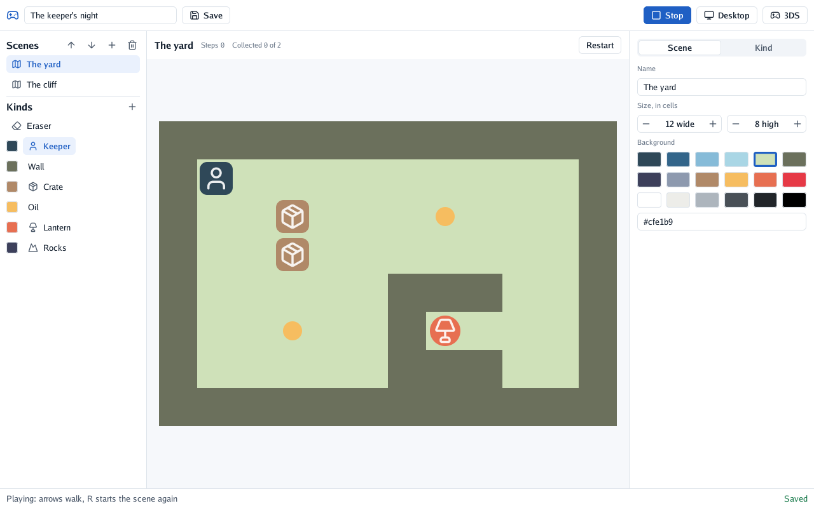
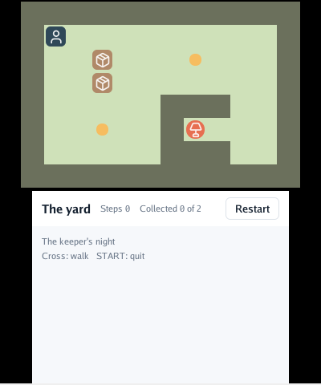

# 🧩 The grid prototype

This is the first prototype, kept while the engine grows: it will be rebuilt on the engine as its 2D part. go-engine made small games on a grid: a player who walks a cell at a time, and things around them
that each do something. This page explains what a game is, how the editor makes one, and how it
becomes a program.

## A game

A game is a JSON file: a **title**, its **kinds** of things and its **scenes**.

| | What it is |
|---|---|
| **Kind** | A kind of thing: a name, a colour, a shape (square, rounded, circle, small) and an icon from [Lucide](https://lucide.dev), and what it does |
| **Scene** | A grid of 3 to 48 cells a side, with a background colour and things placed in its cells, one per cell |
| **Thing** | A kind in a cell |

What a kind does, and a kind may do several of these at once:

| Behaviour | In play |
|---|---|
| Player | Walks with the arrows (the cross on the 3DS); the first one placed is the player |
| Solid | Nothing walks into it |
| Pushable | The player pushes it one cell, if the cell beyond is free |
| Collectable | Taken when the player steps on it |
| Goal | Ends the scene once everything collectable is taken; the last scene's goal wins the game |
| Hazard | Starts the scene again |

The scenes are played in order. Holding an arrow walks: a step at once, then one every 0.15
seconds after a short wait. R starts the scene again.

## The editor

  

| Where | What |
|---|---|
| Toolbar | The game's title, **Save** (Ctrl+S), **Play** / **Stop** (Escape), and the exports |
| Left | The scenes (add, remove, move earlier or later) and the kinds: choosing one paints with it; the eraser empties cells |
| Middle | The scene: press and drag to paint cells with the chosen kind |
| Right | The inspector: the scene (name, size, background) or the kind (name, colour, shape, icon, what it does) |
| Bottom | What the editor last did, and whether the game is saved |

**Play** plays the game from the scene shown, in the middle of the editor, and **Stop** goes back
to editing it as it was.

## Exporting

**Desktop** and **3DS** write the game's program into `exports/` next to the game's file, in a
folder of each target's: the program, its notices (the licenses of what it carries), and in
`source/` the small Go program that was built, which reads the game it embeds and plays it.

| Target | Built with | Needs |
|---|---|---|
| Desktop | Go | Go and a C compiler (go-renderer opens the window with GLFW and OpenGL) |
| Nintendo 3DS | TinyGo, `-target=nintendo3ds` | [tinygo-3ds](https://github.com/akrck02/tinygo-3ds) (set `$TINYGO` if it is not `tinygo` on the path) and devkitPro's 3DS libraries |

The program is built against the go-engine source the editor was built from, so the editor must
run from a build of this repository (`go run` or `go build` here).

  

On the 3DS the scene is on the top screen and the bar on the bottom one, which can be touched; the
cross walks and START ends the program. Copy the `.3dsx` to `/3ds/` on the SD card and open it from
the Homebrew Launcher.

## How it is made

| Package | What it holds |
|---|---|
| `game` | The game's description, its rules (`World`), the walking pace (`Walker`) and its drawing into a `draw2d` list; pure Go, tested |
| `player` | A game played in a go-ui window: the same code on the desktop and on the 3DS (`nintendo3ds.go` puts the scene on the top screen) |
| `editor` | The editor's operations (`editor.go`, tested) and its window (`view.go`) |
| `export` | Writing and building an exported program |
| `cmd/go-engine`, `cmd/play` | The editor and the player |

## Not yet

- Sprites of one's own (kinds are a shape, a colour and an icon), sound and music
  ([go-sound](https://github.com/akrck02/go-sound)), text in scenes.
- Undo, and choosing where to save from a dialog (the path is given on the command line).
- More than one player, things that move on their own, rules of one's own.
- Saving progress on the console.
